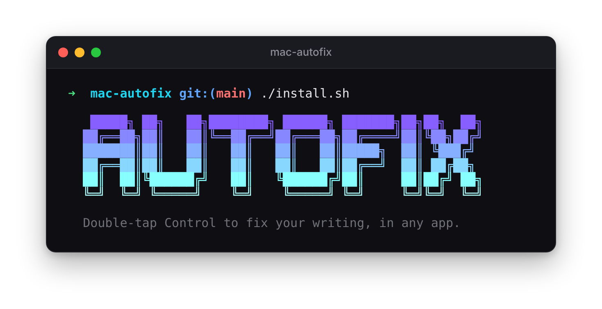
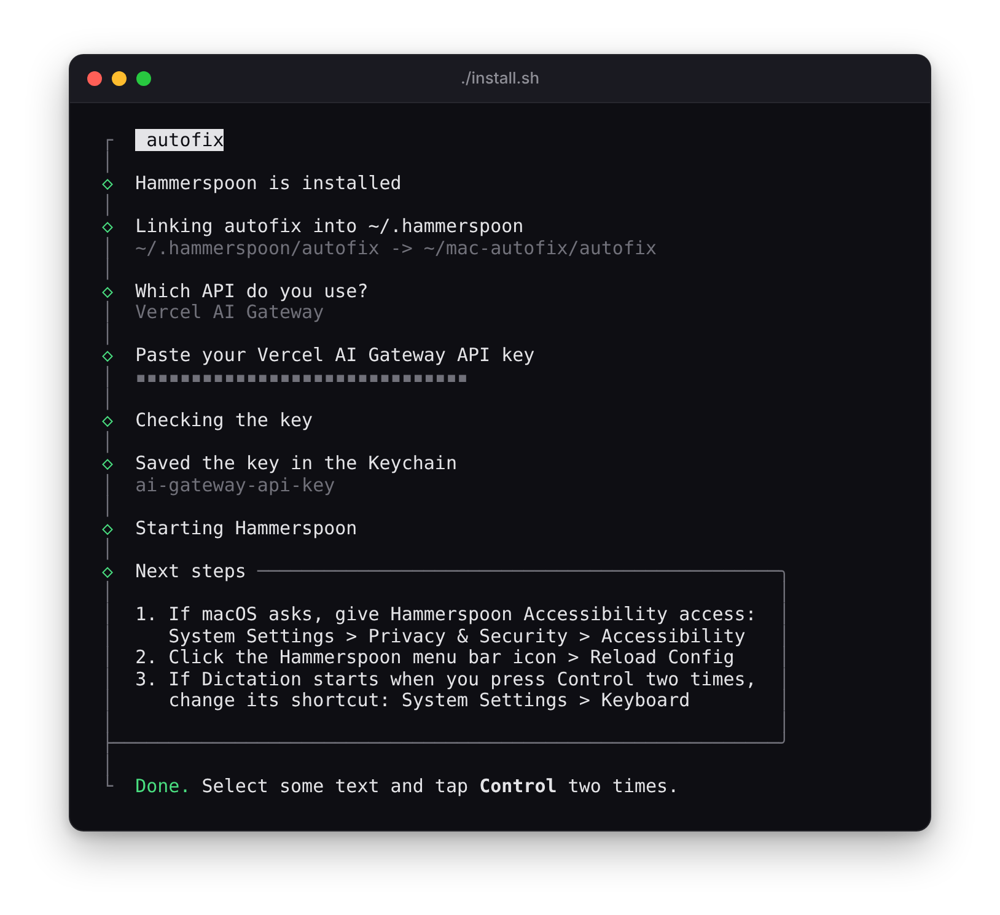

<p align="center">
  
</p>

Double-tap **Control** on your Mac to fix the spelling and grammar of the selected text. The fix replaces the text in place, in any app.

- autofix detects the language and keeps it. It does not translate.
- It keeps your wording, tone and formatting.
- While the model works, a light sweeps over the text and a small bubble shows the status.
- It uses Claude Haiku through Vercel AI Gateway or the Anthropic API. A fix takes approximately one second.

## Requirements

- macOS
- [Homebrew](https://brew.sh). The installer uses it to install [Hammerspoon](https://www.hammerspoon.org).
- An API key for [Vercel AI Gateway](https://vercel.com/docs/ai-gateway) or for [Anthropic](https://console.anthropic.com)

## Install

```bash
git clone https://github.com/maximeantoine1997/mac-autofix.git
cd mac-autofix
./install.sh
```

<p align="center">
  
</p>

The installer does these steps:

1. It installs Hammerspoon if it is not on your Mac.
2. It links the `autofix` folder into `~/.hammerspoon`.
3. It asks for your API key, checks the key and saves it in the macOS Keychain.
4. It starts Hammerspoon and sets it to start at login.

When macOS asks, give Hammerspoon Accessibility access. Then click **Reload Config** in the Hammerspoon menu.

## Use

1. Select text in any app.
2. Tap **Control** two times quickly.

| Bubble | Meaning |
|---|---|
| ⠋ Fixing | The model is working. |
| ✓ Fixed | The corrected text replaced your selection. |
| • Nothing to fix | The text has no errors. |
| • Changed window: fixed text copied | You went to a different window during the fix. Paste the text yourself. |
| ✕ API key rejected | Run `./install.sh --reset-key`. |

## Settings

Edit `autofix/config.lua`. Then click **Reload Config** in the Hammerspoon menu.

| Setting | Default | Use |
|---|---|---|
| `triggerKey` | `"ctrl"` | The key to tap two times: `"ctrl"`, `"alt"`, `"cmd"` or `"shift"`. |
| `doubleTapWindow` | `0.35` | Maximum time between the two taps, in seconds. |
| `providers` | AI Gateway, then Anthropic | API endpoints and models. autofix uses the first provider that has a key in the Keychain. |
| `prompt` | Proofreader | The instructions for the model. |
| `animation` | `true` | Set to `false` to show only the bubble. |
| `theme` | Violet and cyan | The colors of the bubble and of the effect on the text. |

## How it works

1. Hammerspoon monitors the trigger key.
2. autofix gets the position of the selected text from the macOS Accessibility API.
3. It copies the selection, sends it to the model and pastes the result over the selection.
4. It puts your previous clipboard back.

Some apps do not give the position of the selected text. In these apps, the bubble shows at the mouse pointer and the light on the text does not show.

## Privacy

autofix sends only the selected text, and only to the provider that you set. Your API key stays in the macOS Keychain.

## Problems

| Problem | Do this |
|---|---|
| Nothing happens | Make sure that Hammerspoon has Accessibility access. Open the Hammerspoon Console and look for lines that start with `autofix:`. |
| Dictation also starts | Change the Dictation shortcut in System Settings > Keyboard. |
| "No connection" | Make sure that your Mac is online. |

## Uninstall

```bash
./install.sh --uninstall
```

## Files

```
autofix/
  init.lua     trigger, copy, API request, paste
  fx.lua       bubble and effect on the text
  config.lua   your settings
install.sh     installer
assets/        images for this README
```

## License

[MIT](LICENSE)
